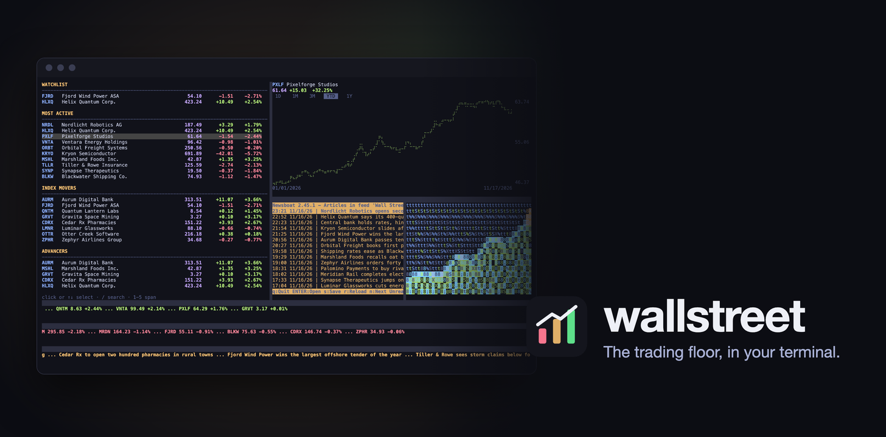
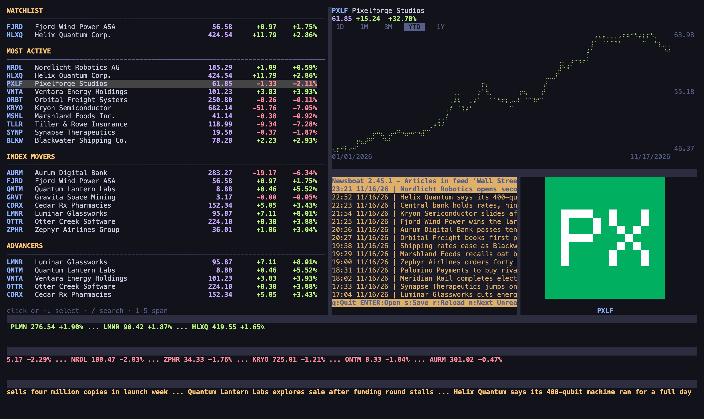
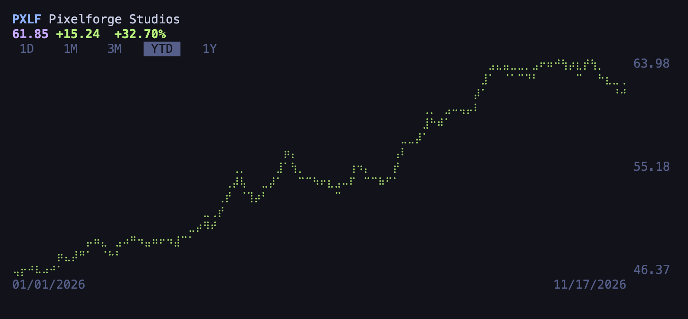
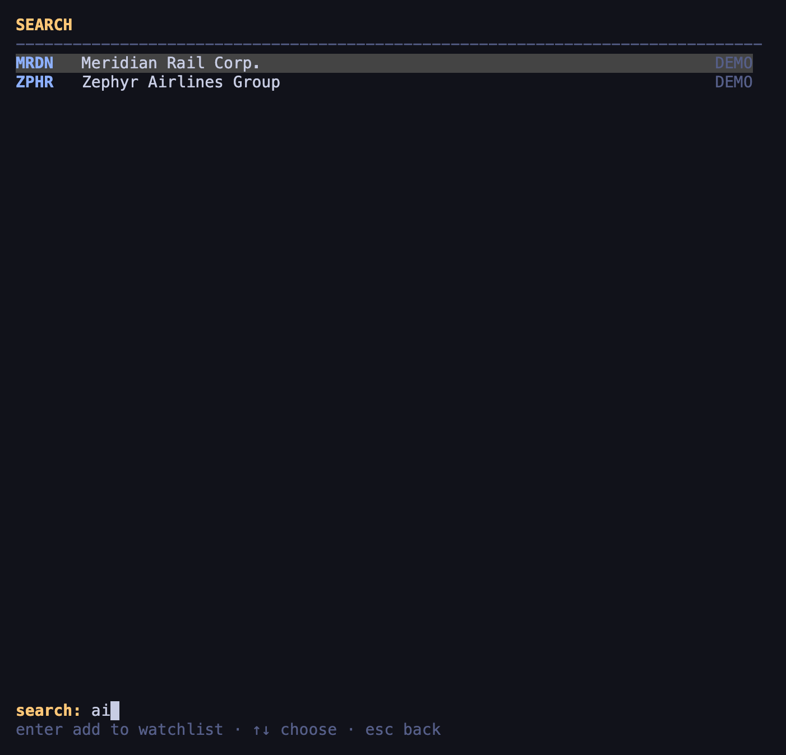

<div align="center">

</div>

# wallstreet

<div align="center">

**Fill your terminal with Wall Street: quotes, tickers and headlines, live.**

<!-- headline - generated by tools/badges.py, refreshed by CI on every push to main -->
[](CHANGELOG.md)
[](bin/wallstreet)
[](tests/)

[](https://www.paypal.com/donate/?business=martin.pfeffer%40celox.io&item_name=wallstreet&currency_code=EUR)

<!-- status -->
[](https://github.com/pepperonas/wallstreet/actions/workflows/tests.yml)
[](https://github.com/pepperonas/wallstreet/actions/workflows/tests.yml)
[](LICENSE)
[](https://semver.org/spec/v2.0.0.html)
[](CHANGELOG.md)
[](https://github.com/pepperonas/wallstreet/releases/latest)
[](https://github.com/pepperonas/wallstreet/commits/main)

<!-- runtime -->
[](share/wallstreet/wsdata)
[](#how-it-works)
[](#demo-mode)
[](#usage)
[](#usage)
[](#how-it-works)
[](#usage)
[](#how-it-works)
[](#data-sources)
[](#installation)

<!-- platforms -->
[](#platform-support)
[](#platform-support)
[](#installation)

<!-- repository -->
[](https://github.com/pepperonas/wallstreet)
[](https://github.com/pepperonas/wallstreet)
[](https://github.com/pepperonas/wallstreet/commits/main)
[](https://github.com/pepperonas/wallstreet/issues)
[](https://github.com/pepperonas/wallstreet/pulls)

<!-- social -->
[](https://github.com/pepperonas/wallstreet/stargazers)
[](https://github.com/pepperonas/wallstreet/network/members)

**[wallstreet.celox.io](https://wallstreet.celox.io)** · [Download](https://wallstreet.celox.io/download) · [Changelog](CHANGELOG.md)

</div>

wallstreet turns a terminal into the screen on a trading desk: a table of the most active
stocks, the chart of the one you click, three tickers running across the bottom — gainers,
losers, headlines — a feed reader and the day's press photos as ASCII art. The numbers and
the news are real.

It started as the sister program of
[Dustin Kirkland's hollywood](https://github.com/dustinkirkland/hollywood). The pages that
version scraped are gone or refuse scripts, and it needs Linux; this project gives it data
sources that answer, runs on macOS and Linux, and has a demo mode for when the content
should not be the day's news.



*The pictures in this README are taken in demo mode: the companies and headlines are invented.*

## Contents

- [Installation](#installation)
- [Usage](#usage)
- [What is on the screen](#what-is-on-the-screen)
- [Data sources](#data-sources)
- [Demo mode](#demo-mode)
- [How it works](#how-it-works)
- [Untrusted data](#untrusted-data)
- [Platform support](#platform-support)
- [Development](#development)
- [Troubleshooting](#troubleshooting)
- [Support this project](#support-this-project)
- [Changelog](#changelog)
- [License](#license)
- [Author](#author)

## Installation

**Homebrew** (macOS, also Linuxbrew) — installs wallstreet and the programs its panes use:

```sh
brew install pepperonas/tap/wallstreet
```

**Installer script** — downloads the newest release, verifies its SHA-256 and installs into
`~/.local` (no root; `PREFIX=/usr/local` for a system-wide copy):

```sh
curl -fsSL https://github.com/pepperonas/wallstreet/releases/latest/download/install.sh | sh
```

**From a checkout** — nothing to build:

```sh
git clone https://github.com/pepperonas/wallstreet.git
brew install tmux newsboat      # Debian/Ubuntu: apt install tmux newsboat
wallstreet/bin/wallstreet
```

`tmux` and Python 3.9 or newer are required. Without `newsboat` the feed reader stays away.

## Usage

```sh
wallstreet              # live data
wallstreet --demo       # invented data, nothing is fetched
wallstreet --version
```

| Where | Input | What it does |
|---|---|---|
| quote table | click on a row | select that stock |
| quote table | `↑` `↓`, `j` `k`, mouse wheel | move the selection |
| quote table | `/`, or a click on the hint line | search a stock by name or symbol; `Enter` or a click adds it to the watchlist and shows its chart, `Esc` goes back |
| quote table | `d` on a watchlist row | remove it from the watchlist |
| quote table or chart | `1` `2` `3` `4` `5` | span of the chart: day, month, three months, year to date, year |
| chart | click on `1D` `1M` `3M` `YTD` `1Y` | open that span |
| chart | click elsewhere, `→` `←` | next or previous span |
| any pane | `Ctrl-C` | quit |

Clicks need tmux's mouse support. Started from a plain terminal, wallstreet creates a tmux
session named `wallstreet`, switches the mouse on there and closes the session again when
you quit. Inside an existing tmux session it opens one window, leaves the rest alone and
does not touch your mouse setting — the keys work either way, and `set -g mouse on` makes
the clicks work too. A click on a pane also makes it the one that gets the keys.

The layout follows the terminal: from 150 columns all seven panes, below that without the
logo, below 110 columns the quote table and the tickers only.

## What is on the screen

| Pane | What it shows |
|---|---|
| **Quotes** | your watchlist, then most active stocks by dollar volume, Nasdaq-100 movers, advancers, decliners — symbol, name, last price, change, percent; green for up, red for down; one row is selected; redrawn every minute and when the pane is resized |
| **Chart** | the course of the selected stock in braille characters, with last price, change over the span and the axis values. The day runs from the opening bell at 9:30 New York time, with yesterday's close as a dotted line and after-hours trading in grey; month, three months, year to date and year are daily closes ending with today's price |
| **Gainers ticker** | the day's biggest gainers, scrolling, green |
| **Losers ticker** | the day's biggest losers, scrolling, red |
| **Headlines ticker** | headlines from all feeds, shuffled, scrolling, yellow |
| **Feed reader** | [newsboat](https://newsboat.org) on the same feeds, reloading by itself |
| **Picture** | a press photo from the feeds as coloured ASCII art, a new one every ten seconds |

| | |
|---|---|
|  |  |

### The logo

Beside the feed reader stands the logo of the company you selected. Where the terminal
draws pictures — iTerm2, WezTerm and other sixel terminals — it is a real picture of up to
576 pixels a side; inside tmux that needs tmux 3.4 or newer with sixel support, and every
terminal attached to the session has to be able to. Everywhere else it is drawn with
half-block characters, two pixels per character cell, in 24-bit colour if the terminal has
it. `WALLSTREET_LOGO=blocks` keeps the characters in any case. A logo drawn in white gets a dark tile, every
other a light one. A company neither source has a logo for gets a monogram: the first two
letters of its symbol on a colour of its own. The old news picture (`lib/wallstreet/img2txt`,
needs libcaca) is still in the package but no longer on the default screen.

## Data sources

| What | From | Refreshed |
|---|---|---|
| quotes, gainers, losers | `api.nasdaq.com/api/marketmovers` — no key, no account | every 55 s |
| search | `api.nasdaq.com/api/autocomplete/slookup` — stocks and ETFs; notes and mutual funds are left out, they have no course to draw | on typing, an hour per query |
| chart of one stock | `api.nasdaq.com/api/quote/<symbol>/chart` | every minute (day), every hour (longer spans) |
| the day's result, yesterday's close, after-hours price | `api.nasdaq.com/api/quote/<symbol>/info` | every minute |
| logo of the selected company | `assets.parqet.com/logos/symbol/<symbol>` (512 px), else `financialmodelingprep.com/image-stock/<symbol>.png` — these two learn which symbol you selected | once, kept 30 days |
| headlines, feed reader | the RSS feeds in `share/wallstreet/newsboat.urls`: BBC, CNBC, MarketWatch, WSJ | every 5 min |

The quotes are the day's movements on the US exchanges; outside trading hours the last
close stays on screen. To follow other news, edit `newsboat.urls` — the one list feeds the
reader and the ticker.

What was replaced, and why: Yahoo Finance answers scripts with 429, the markets page of
wsj.com with 403, the Reuters feeds are switched off, and the CNN feeds have carried no new
entry since 2023.

The table of movers is what Nasdaq publishes for the day; any other stock is one search
away and stays in your watchlist.

These are other people's services. They may change or go away, and wallstreet is not
affiliated with any of them; if a source stops answering, the last good state stays on
screen and the pane says so once there is none.

## Demo mode

```sh
wallstreet --demo
```

Twenty companies that do not exist, with prices that drift a little every minute and a
course for every span that ends at the price in the table, two dozen invented headlines,
and a monogram where the logo would be. Nothing is fetched. Use it for
screenshots, presentations and screens in the background of a film — or on a machine
without a network.

## How it works

`bin/wallstreet` starts a tmux session and lays out the panes; each pane runs one small
script from `lib/wallstreet/`. All of them get their content from **`share/wallstreet/wsdata`**
— one Python file, standard library only — which fetches, caches and renders:

```sh
share/wallstreet/wsdata browse           # the quote table, interactive
share/wallstreet/wsdata chart            # the chart of the selected stock
share/wallstreet/wsdata table            # the quote table as plain output
share/wallstreet/wsdata movers up        # one line of gainers
share/wallstreet/wsdata headlines        # one headline per line
share/wallstreet/wsdata image            # path of a downloaded picture
share/wallstreet/wsdata marquee yellow 0.08 "some text"
```

The cache lives in `~/Library/Caches/wallstreet` (macOS) or `~/.cache/wallstreet`: quotes
for 55 seconds, feeds for 5 minutes, pictures for a day. The table and the chart are two
processes in two panes; what is selected travels through one small file in the same
directory, and the watchlist is another one. Several panes share one request,
and when the network is down the last good state is used. No telemetry, no account, no
configuration.

## Untrusted data

Quotes and feeds come from the network and are treated as untrusted:

- control characters are removed before anything is printed, so a headline or a company
  name cannot send escape sequences to the terminal;
- pictures are fetched over http(s) from public hosts only — no local files, no addresses
  inside your own network, redirects included — and answers above 8 MB are dropped;
- the cache directory is writable by you alone and is checked before use.

## Platform support

| Platform | Status |
|---|---|
| macOS (Apple silicon) | developed and run here — macOS 27, tmux 3.8, Python 3.9 and 3.15 |
| macOS (Intel) | expected to work, not run |
| Linux | the test suite runs in CI; a full run in a terminal has not been done |

## Development

```sh
python3 -m unittest discover -s tests -v    # the suite: no network, no tmux
tools/screenshots.sh                        # docs/screenshots/*.png, in demo mode
python3 tools/website_art.py                # banner, hero and mark
python3 tools/badges.py                     # the three counted README badges
```

The tests load `wsdata` with a private cache directory and either the demo data or a
patched fetch: the URL filter, the cache (reuse, replacement, stale copy on failure), the
table (never wider or higher than the terminal, never ending on a bare heading), keyboard
and mouse input, the search and the watchlist, the selection file, the chart (no gaps in the line, fits its pane), the
ticker, feed parsing with hostile input, and the shell side of every pane.

A release is a tag: `git tag v1.2.3 && git push --tags`. The workflow checks that the tag
matches `VERSION`, runs the tests, builds `wallstreet.tar.gz`, `install.sh` and
`SHA256SUMS`, and publishes them with the changelog section as notes.

## Troubleshooting

- **"No market data available right now."** The Nasdaq API did not answer and there is no
  cached copy yet. It is tried again every minute; `wallstreet --demo` works without it.
- **A click does nothing.** tmux's mouse support is off in your own session: `tmux set -g mouse on`, or use the arrow keys.
- **The day's chart differs from another site before 9:30 or after 16:00.** The coloured part is the regular session; what trades after the close is grey, and the header names the after-hours price beside the day's result.
- **"No chart data for this symbol right now."** Nasdaq has no course for some warrants and units among the movers; pick another row.
- **The feed reader or the logo is missing.** `newsboat` is not installed,
  or the terminal is narrower than 110 or 150 columns.
- **A feed shows nothing.** Feeds move; check the URL in `newsboat.urls` in a browser.
- **Old data after editing the feed list.** Remove the cache directory named above.

## Support this project

wallstreet is free, Apache-licensed, ad-free and telemetry-free, and it will stay that way. If it
made a demo, a film set or a slow afternoon better, a coffee is always welcome:

<div align="center">

[](https://www.paypal.com/donate/?business=martin.pfeffer%40celox.io&item_name=wallstreet&currency_code=EUR)

</div>

Not in a position to donate? A star, a bug report, or a note about how it behaves on a
machine I do not own is worth just as much.

## Changelog

See [CHANGELOG.md](CHANGELOG.md). The project follows
[Semantic Versioning](https://semver.org/spec/v2.0.0.html).

## License

[Apache-2.0](LICENSE). wallstreet was written by Dustin Kirkland as part of hollywood (2014–2026); this project keeps his licence and his copyright notices. What was changed is listed in [NOTICE](NOTICE).

## Author

**Martin Pfeffer**

- Website: [celox.io](https://celox.io)
- GitHub: [@pepperonas](https://github.com/pepperonas)

Original work: **Dustin Kirkland** — [hollywood.computer](https://hollywood.computer)
